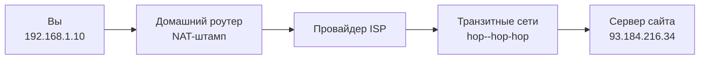

# Модуль 02 · Как работает интернет без VPN

> [!tip] Интерактивная версия
> Полная версия с играми: откройте `vpn/02-kak-rabotaet-internet-bez-vpn.html` в браузере. Внутри 6 игровых механик: путь посылки по «городу», конструктор пакета, дом с портами, игра «ты — роутер», штамп-машина NAT и переключатель «открытка/сейф».

Хаб курса: [[README|VPN: как это работает]] · Прошлый модуль: [[01-chto-takoe-vpn]] · Следующий: [[03-tunnel-i-perehvat-trafika]]

## Содержание

1. [Главная метафора: интернет — город посылок](#главная-метафора-интернет--город-посылок)
2. [Пакет: из чего состоит](#пакет-из-чего-состоит)
3. [IP-адрес и порт: адрес и домофон](#ip-адрес-и-порт-адрес-и-домофон)
4. [DNS: телефонная книга интернета](#dns-телефонная-книга-интернета)
5. [Роутеры и маршрутизация: как выбирается путь](#роутеры-и-маршрутизация-как-выбирается-путь)
6. [NAT: один адрес на всю квартиру](#nat-один-адрес-на-всю-квартиру)
7. [HTTP и HTTPS: открытка и сейф](#http-и-https-открытка-и-сейф)
8. [Итог: полный путь за секунду](#итог-полный-путь-за-секунду)
9. [Словарик сокращений](#словарик-сокращений)
10. [Источники](#источники)

---

## Главная метафора: интернет — город посылок

Представьте, что интернет — это гигантский город, а любые данные (сообщение, фото, кусок видео) нарезаются на **посылки-пакеты** и ездят по городу от дома к дому через почты-перевалочные пункты.

- Ваш компьютер — **дом отправителя**.
- Сайт — **дом получателя** на другом конце города.
- Домашний роутер — **районная почта**: принимает посылки из дома и решает, куда дальше.
- Провайдер, ISP (Internet Service Provider — поставщик интернет-услуг, ваш оператор связи) — **главный почтамт города**: знает маршруты в другие районы.
- Транзитные сети — **сети дорог между районами и городами**.

Никакой магии: каждая посылка подписана, каждая почта смотрит только на адрес и передаёт дальше.

## Пакет: из чего состоит

Пакет (packet) — это конверт с письмом внутри. У конверта есть **заголовок (header)** — всё, что нужно для доставки, а внутри — **полезная нагрузка (payload)** — сами данные.

| Часть конверта | Что это | Аналогия |
|---|---|---|
| Адрес получателя | IP-адрес сайта | «Куда везти» |
| Адрес отправителя | Ваш IP-адрес | «Куда слать ответ» |
| Порт получателя | Номер сервиса (443, 80…) | «Какой квартире доставить» |
| Данные | Кусочек вашего запроса или страницы | Само письмо |

Важно: **конверт не запечатан** — адрес отправителя виден каждой почте по пути. Именно поэтому сайт узнаёт «кто прислал посылку», а провайдер — «кто и куда пишет». Это и есть ответ на вопрос «что такое IP источника и кто его узнаёт».

## IP-адрес и порт: адрес и домофон

- **IP (Internet Protocol — интернет-протокол)** — «язык адресов», по которому устройства находят друг друга. IP-адрес — как домашний адрес: `93.184.216.34` — это «улица, дом» в цифровом городе.
- **Порт (port)** — номер «квартиры» в доме-компьютере. Один сервер может одновременно быть и сайтом, и почтой: сайту посылки несут в квартиру 443, почте — в квартиру 25.
- Популярные «квартиры»: 80 — обычный веб (HTTP, HyperText Transfer Protocol — протокол передачи гипертекста), 443 — защищённый веб (HTTPS, HyperText Transfer Protocol Secure — тот же протокол, но зашифрованный), 53 — телефонная книга (DNS), 25 — почта (SMTP, Simple Mail Transfer Protocol — простой протокол передачи почты).
- Компьютеры в домашней сети, LAN (Local Area Network — локальная сеть, например ваша квартира по Wi-Fi, Wireless Fidelity — «беспроводная точность», так называется беспроводная сеть), получают «внутриквартирные» адреса вида `192.168.x.x` — снаружи они не видны.

## DNS: телефонная книга интернета

Компьютеры не понимают `example.com` — они понимают только числа-адреса. **DNS (Domain Name System — система доменных имён)** работает как справочная: «Где живёт сайт example.com?» — «93.184.216.34». Браузер звонит в справочную **до** отправки посылки, поэтому провайдер обычно видит, к каким доменам вы обращаетесь, даже если сами посылки зашифрованы.

## Роутеры и маршрутизация: как выбирается путь

**Роутер (router, маршрутизатор)** — почта-распределитель. Он не знает всего города наизусть, у него есть **таблица маршрутизации (routing table)** — шпаргалка: «адреса, начинающиеся на 192.168 — это ко мне домой, всё остальное — главному почтамту (провайдеру)».

У почтамта шпаргалка побольше: «8.8.x.x — туда, 93.184.x.x — вон в тот туннель под горой». Посылка прыгает от роутера к роутеру (каждый прыжок — **hop**), и у каждого одна забота: прочитать адрес получателя и передать соседу, который «ближе к цели». Полной карты нет ни у кого — и это нормально.

## NAT: один адрес на всю квартиру

У вас дома телефон, ноутбук и телевизор — у каждого свой внутренний адрес `192.168.1.x`. Но провайдер выдал вам **один** внешний адрес. Как все трое выходят в интернет?

Работает **NAT (Network Address Translation — преобразование сетевых адресов)** — штамп-машина в роутере:

1. Посылка от ноутбука `192.168.1.11:51000` приходит к роутеру.
2. Роутер **зачёркивает** внутренний адрес и **штампует** свой внешний: `84.201.100.7:62002`.
3. Запись «62002 ↔ ноутбук, 51000» попадает в блокнотик роутера (NAT-таблицу).
4. Ответ приходит на `84.201.100.7:62002` — роутер смотрит в блокнотик и несёт его ноутбуку.

Для всего интернета ваша семья — **один адрес**. Сайты видят внешний адрес роутера, а не ваши `192.168.x.x`. Спойлер: VPN-сервер делает почти такой же трюк со своим адресом — поэтому и «меняется IP» (модуль [[04-pochemu-menyaetsya-ip]]).

## HTTP и HTTPS: открытка и сейф

- **HTTP** — посылка-открытка: текст виден каждому, кто несёт её по пути. Провайдер читает содержимое.
- **HTTPS** — та же открытка, но запертая в **сейф**. Сейф запирается протоколом TLS (Transport Layer Security — «безопасность транспортного уровня», протокол шифрования соединения; подробнее — модуль [[05-shifrovanie-i-kluchi]]). Ключ от сейфа есть только у вас и у сайта: промежуточные почты видят только конверт (адреса, объём, время), но не письмо.

Но даже с HTTPS провайдер видит **домен** — из DNS-запроса и из поля SNI (Server Name Indication — «указание имени сервера») при установке TLS-соединения. Полностью скрывает и домены только VPN-туннель (модуль [[03-tunnel-i-perehvat-trafika]]).

Передача по надёжному каналу обычно идёт по TCP (Transmission Control Protocol — протокол управления передачей): он следит, чтобы пакеты дошли по порядку и без потерь — как заказные письма с уведомлением о вручении.

## Итог: полный путь за секунду

1. Вы ввели URL (Uniform Resource Locator — адрес страницы, например `https://example.com/cat.png`).
2. Браузер спросил у DNS: какой IP у `example.com`?
3. Запрос нарезали на пакеты, подписали конверты (ваш IP → IP сайта, порт 443).
4. Домашний роутер проштамповал их своим внешним адресом (NAT) и передал провайдеру.
5. Провайдер и транзитные сети передавали пакеты по шпаргалкам-маршрутам, hop за hop.
6. Сайт получил пакеты, расшифровал (TLS), собрал страницу и отправил ответ тем же путём.
7. Роутер по блокнотику NAT раздал ответы нужным устройствам.

Без VPN каждый шаг виден посредникам: провайдер знает ваш IP, домены и объёмы; сайт знает ваш внешний IP. VPN (Virtual Private Network — виртуальная частная сеть, см. [[01-chto-takoe-vpn]]) добавляет к этому пути один хитрый крюк — о нём в следующем модуле.

## Словарик сокращений

| Сокращение | Расшифровка | По-простому |
|---|---|---|
| IP | Internet Protocol | язык адресов в интернете |
| ISP | Internet Service Provider | ваш провайдер связи |
| DNS | Domain Name System | телефонная книга интернета |
| URL | Uniform Resource Locator | адрес страницы |
| HTTP | HyperText Transfer Protocol | открытка (не шифруется) |
| HTTPS | HyperText Transfer Protocol Secure | открытка в сейфе |
| TLS | Transport Layer Security | замок-протокол для HTTPS |
| TCP | Transmission Control Protocol | заказные письма с описью |
| NAT | Network Address Translation | штамп-машина в роутере |
| LAN | Local Area Network | домашняя сеть |
| Wi-Fi | Wireless Fidelity | беспроводная домашняя сеть |
| SNI | Server Name Indication | «имя сайта» при установке TLS |
| VPN | Virtual Private Network | приватный туннель (модуль 01) |

## Источники

- [RFC 791 — Internet Protocol](https://datatracker.ietf.org/doc/html/rfc791) — как устроены IP-адреса и пакеты
- [RFC 793 — Transmission Control Protocol](https://datatracker.ietf.org/doc/html/rfc793) — надёжная доставка пакетов
- [RFC 3022 — Traditional IP Network Address Translator](https://datatracker.ietf.org/doc/html/rfc3022) — классический NAT
- [RFC 8446 — The Transport Layer Security (TLS) Protocol Version 1.3](https://datatracker.ietf.org/doc/html/rfc8446) — шифрование HTTPS
- [MDN — Как работает интернет](https://developer.mozilla.org/ru/docs/Learn_web_development/Howto/Web_mechanics/How_does_the_Internet_work)
- [MDN — What is a URL](https://developer.mozilla.org/en-US/docs/Learn_web_development/Howto/Web_mechanics/What_is_a_URL)
