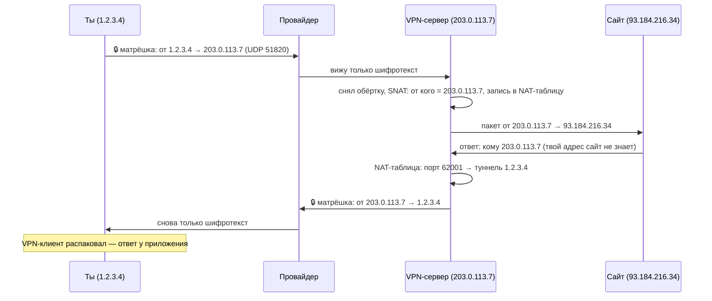

# Модуль 04 · Почему меняется IP источника

> [!tip] Интерактивная версия
> Полная версия с играми: откройте `vpn/04-pochemu-menyaetsya-ip.html` в браузере. Внутри: полный путь пакета «туда и обратно» со step-навигацией, штамп-машина на VPN-сервере (три пользователя — один IP) и конструктор обратного пути.

Хаб курса: [[README|VPN: как это работает]] · Прошлый модуль: [[03-tunnel-i-perehvat-trafika]] · Следующий: [[05-shifrovanie-i-kluchi]]

## Содержание

1. [Напоминание: пакет уже в туннеле](#напоминание-пакет-уже-в-туннеле)
2. [Точка выхода: штамп-машина SNAT](#точка-выхода-штамп-машина-snat)
3. [Почему сайт видит IP сервера](#почему-сайт-видит-ip-сервера)
4. [Обратный путь: как ответ находит вас](#обратный-путь-как-ответ-находит-вас)
5. [Один адрес на всех: несколько пользователей](#один-адрес-на-всех-несколько-пользователей)
6. [Кто что видит: итоговая таблица](#кто-что-видит-итоговая-таблица)
7. [Что всё-таки выдаёт вас сайту](#что-всё-таки-выдаёт-вас-сайту)
8. [Итог: полный путь туда и обратно](#итог-полный-путь-туда-и-обратно)
9. [Словарик сокращений](#словарик-сокращений)
10. [Источники](#источники)

---

## Напоминание: пакет уже в туннеле

В модуле [[03-tunnel-i-perehvat-trafika]] мы разобрали перехват: ОС (операционная система) несёт каждый пакет в волшебную дверь TUN (network TUNnel — «сетевой туннель»), VPN-клиент шифрует его и упаковывает в матрёшку — внешний пакет от вашего реального IP-адреса до VPN-сервера. Провайдер, ISP (Internet Service Provider — поставщик интернет-услуг), видит только внешний конверт.

Остаётся вопрос: **что происходит на выходе и почему весь интернет начинает считать тебя VPN-сервером?**

## Точка выхода: штамп-машина SNAT

VPN-сервер — это **точка выхода (exit node)**: место, где твой трафик покидает туннель и уходит в большой интернет. Он делает с матрёшкой три вещи:

1. **Снимает обёртку** (декапсуляция): убирает внешний конверт, расшифровывает — достаёт твой исходный пакет «от 192.168.1.10 (через NAT роутера — 1.2.3.4) к 93.184.216.34».
2. **Штампует свой адрес** — это SNAT (Source Network Address Translation — подмена адреса источника): в поле «от кого» твой IP зачёркивается, вписывается адрес сервера `203.0.113.7`. Тот же фокус, что делал твой домашний роутер в модуле [[02-kak-rabotaet-internet-bez-vpn]], только теперь вместо адреса роутера — адрес VPN-сервера.
3. **Записывает в блокнот** (NAT-таблица, Network Address Translation — преобразование сетевых адресов): «этот пакет пришёл из туннеля пользователя 1.2.3.4, ушёл в интернет под портом 62001; ответ на него — вернуть в этот туннель».

Дальше пакет уходит к сайту **от имени сервера**. Сайт отвечает на `203.0.113.7` — потому что другого адреса он просто не знает.

## Почему сайт видит IP сервера

Сети доверяют только тому, что написано на конверте. Сайт получает пакет «от 203.0.113.7» — и для него отправитель и есть 203.0.113.7. Твоего адреса в пакете **нет физически**: он остался во внешнем конверте матрёшки, который сервер снял и выбросил.

Это не «обман» и не взлом — обычная механика интернета: точно так же работают домашние роутеры (вся семья за одним адресом), корпоративные шлюзы и мобильные операторы (тысячи абонентов за несколькими NAT-адресами). VPN просто добавляет в цепочку ещё одну штамп-машину — свою.

## Обратный путь: как ответ находит вас

Сайт шлёт ответ на `203.0.113.7` — на VPN-сервер. Как сервер понимает, что это тебе?

1. Ответ приходит на **внешний порт из блокнота** (например, `:62001`).
2. Сервер смотрит NAT-таблицу: порт 62001 → «туннель пользователя 1.2.3.4».
3. Упаковывает ответ в новую матрёшку: шифрует, внешний конверт — «от 203.0.113.7 к 1.2.3.4», протокол UDP (User Datagram Protocol — протокол пользовательских датаграмм), порт 51820.
4. Отправляет через обычный интернет. Провайдер видит лишь продолжение твоего зашифрованного туннеля.
5. Дома VPN-клиент снимает обёртку, расшифровывает — и отдаёт ответ тому приложению, которое его ждало.

**Ответ всегда идёт через туннель обратно** — именно поэтому подмена адреса и работает: и туда, и назад трафик ходит одним и тем же маршрутом «ты ↔ VPN-сервер».

## Один адрес на всех: несколько пользователей

За одним VPN-сервером обычно сидят сотни людей. Для сайта все их запросы приходят **с одного IP-адреса** — серверного. Отличить пользователя от пользователя сайт может только по портам источника (которые никто не смотрит) и по не-сетевым признакам: куки, аккаунты, отпечаток браузера (подробнее — [[09-utechki-i-ogranicheniya]]).

Отсюда два важных следствия:

- **Плюс**: сайты и трекеры не могут привязать твою активность к твоему реальному IP.
- **Минус**: VPN-сервер знает о тебе всё (твой IP + весь трафик в открытом виде после распаковки) и может отличить тебя от других. Доверие к VPN-провайдеру — ключевой вопрос курса.

## Кто что видит: итоговая таблица

| Участник | Что видит |
|---|---|
| **Сайт** | IP VPN-сервера как источник; данные запроса; куки/аккаунт. Твоего IP не знает |
| **VPN-сервер** | Твой реальный IP, весь трафик в открытом виде, все домены |
| **Провайдер (ISP)** | Только зашифрованный туннель «ты ↔ VPN-сервер»: объём, время. Ни доменов, ни содержимого |
| **Ты** | Всё как обычно — приложения не замечают VPN |

## Что всё-таки выдаёт вас сайту

Подмена IP — не невидимость. Сайт по-прежнему узнаёт тебя по:

- **Куки и аккаунты**: залогинен — значит, известен, с какого бы IP ни пришёл.
- **Отпечатку браузера (fingerprinting)**: шрифты, разрешение, версия ОС складываются в узнаваемый узор.
- **Утечкам в самом браузере**: WebRTC и DNS-запросы мимо туннеля (модуль [[09-utechki-i-ogranicheniya]]).

VPN меняет **сетевой** адрес. Всё, что выше сети, — другая история.

## Итог: полный путь туда и обратно

Цепочка простая: **туннель заканчивается на VPN-сервере, а подмена адреса — это штамп в его руках**. Осталось разобраться, что именно делает туннель нечитаемым для провайдера — шифрование и ключи, модуль [[05-shifrovanie-i-kluchi]].

## Словарик сокращений

| Сокращение | Расшифровка | По-простому |
|---|---|---|
| VPN | Virtual Private Network | приватный туннель (модуль 01) |
| IP | Internet Protocol | язык адресов в интернете |
| ISP | Internet Service Provider | твой провайдер связи |
| NAT | Network Address Translation | штамп-машина, подменяющая адреса |
| SNAT | Source NAT | подмена адреса отправителя |
| TUN | network TUNnel | виртуальная дверь для IP-пакетов |
| UDP | User Datagram Protocol | быстрая почта без уведомлений |
| OS | Operating System | операционная система |

## Источники

- [RFC 3022 — Traditional IP Network Address Translator](https://datatracker.ietf.org/doc/html/rfc3022) — механика NAT/SNAT
- [RFC 8985 — The WireGuard VPN Protocol](https://datatracker.ietf.org/doc/html/rfc8985) — туннель и упаковка в UDP
- [WireGuard Whitepaper](https://www.wireguard.com/papers/wireguard.pdf) — криптография туннеля
- [WireGuard Quick Start](https://www.wireguard.com/quickstart/) — AllowedIPs и маршруты на практике
- [OpenVPN — Tunneling (docs)](https://docs.openvpn.net/openvpn/tunneling/) — точка выхода и маршрутизация
