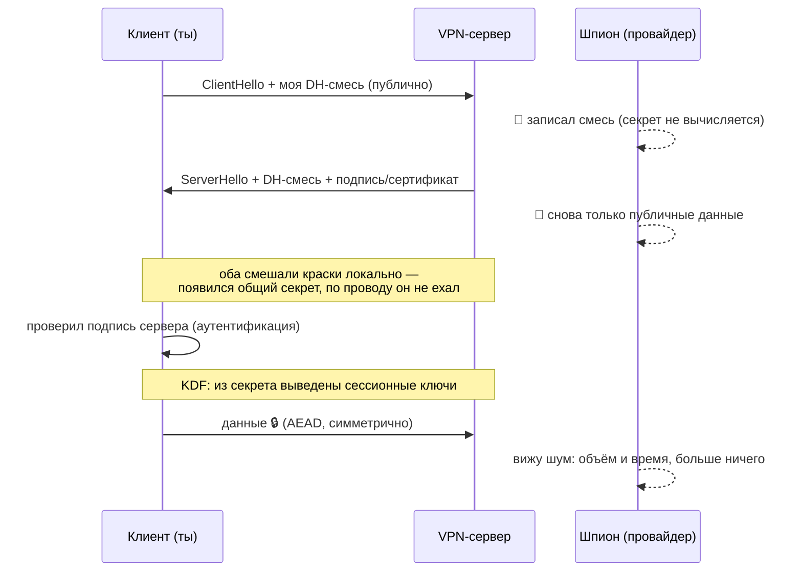

# Модуль 05 · Шифрование внутри туннеля

> [!tip] Интерактивная версия
> Полная версия с играми: откройте `vpn/05-shifrovanie-i-kluchi.html` в браузере. Внутри: Diffie-Hellman на банках с краской, путь рукопожатия со step-навигацией (и шпионом на проводе) и конструктор защищённой сессии.

Хаб курса: [[README|VPN: как это работает]] · Прошлый модуль: [[04-pochemu-menyaetsya-ip]] · Следующий: [[06-protokoly-vpn]]

## Содержание

1. [Туннель построен. А что внутри конверта?](#туннель-построен-а-что-внутри-конверта)
2. [Симметричная криптография: один ключ на двоих](#симметричная-криптография-один-ключ-на-двоих)
3. [Асимметричная криптография: почтовый ящик со щелью](#асимметричная-криптография-почтовый-ящик-со-щелью)
4. [Diffie-Hellman: договориться о ключе на виду у всех](#diffie-hellman-договориться-о-ключе-на-виду-у-всех)
5. [Handshake: от «привета» к сессионным ключам](#handshake-от-привета-к-сессионным-ключам)
6. [Аутентификация: откуда знать, что сервер — настоящий](#аутентификация-откуда-знать-что-сервер--настоящий)
7. [Сессия: ключи живут, меняются и умирают](#сессия-ключи-живут-меняются-и-умирают)
8. [Что видит провайдер: шум и немного метаданных](#что-видит-провайдер-шум-и-немного-метаданных)
9. [Как это устроено в реальных протоколах](#как-это-устроено-в-реальных-протоколах)
10. [Итог: рукопожатие целиком](#итог-рукопожатие-целиком)
11. [Словарик сокращений](#словарик-сокращений)
12. [Источники](#источники)

---

## Туннель построен. А что внутри конверта?

В модулях [[03-tunnel-i-perehvat-trafika]] и [[04-pochemu-menyaetsya-ip]] мы собрали механику: VPN (Virtual Private Network — виртуальная частная сеть) перехватывает твои пакеты, пакует их в матрёшку и отправляет на сервер, который подменяет твой адрес своим. Провайдер, ISP (Internet Service Provider — поставщик интернет-услуг), видит только внешний конверт.

Но конверт — это половина дела. Если бы внутри матрёшки лежал твой пакет **в открытом виде**, провайдеру и не нужен был бы внутренний конверт: он видит весь трафик туннеля, проходящий через его провода, и мог бы прочитать содержимое. Внешний конверт говорит лишь «от кого и кому», а вот **что** внутри — знает только тот, у кого есть ключ.

Этот модуль — про замок внутри матрёшки: как двое договариваются о ключе на виду у всего интернета, почему подслушивающий получает только «шум», и что происходит с ключами дальше.

## Симметричная криптография: один ключ на двоих

**Симметричное шифрование (symmetric encryption)** — это замок с одним ключом: что закрывается, тем и открывается. Отправитель шифрует сообщение ключом, получатель расшифровывает **тем же самым** ключом.

Аналогия: два друга заранее сделали дубликат одного ключа от почтового ящика. Закрыл ящик — открыть может только тот, у кого дубликат.

- **Плюсы**: очень быстро. Современные симметричные шифры (ChaCha20, AES) работают на гигабитах в секунду даже на телефоне. Именно поэтому весь трафик внутри туннеля шифруется симметрично.
- **Минус один, но фундаментальный**: ключ надо **как-то передать второму**. Если послать его по тому же проводу — подслушивающий перехватит ключ и сможет читать всё. Это называется **проблемой распределения ключей (key distribution problem)**, и вокруг неё построена вся современная криптография.

Хакерская заметка: «взломать» AES-256 перебором нереально — ключей больше, чем атомов в галактике. Все реальные атаки идут **вокруг** шифра: через слабую математику согласования, украденные ключи или подменённого собеседника.

## Асимметричная криптография: почтовый ящик со щелью

**Асимметричное шифрование (asymmetric encryption)** решает проблему передачи: у каждого участника **пара ключей** — публичный (public key) и приватный (private key). Что зашифровано публичным, расшифровывается только приватным, и наоборот.

Аналогия: почтовый ящик со щелью. Ящик и щель видны всем (публичный ключ) — любой может бросить письмо. Но открыть ящик можно только ключом, который есть у владельца (приватный ключ).

- **Плюсы**: приватный ключ **никогда не передаётся по сети**. Его нельзя перехватить, потому что его там нет.
- **Минусы**: медленно — в сотни и тысячи раз медленнее симметричного. Шифровать им весь трафик туннеля непрактично.

Поэтому в жизни работает **гибридная схема**: асимметричная криптография — только чтобы **договориться** (рукопожатие), симметричная — чтобы **шифровать данные** (сессия). Дорогой замок на двери — один раз; дешёвый ключ в кармане — на каждый день.

## Diffie-Hellman: договориться о ключе на виду у всех

**Diffie-Hellman (DH, обмен ключами Диффи—Хеллмана)** — фокус, который позволяет двум незнакомцам получить **общий секрет**, обмениваясь только публичными данными. Подслушивающий видит весь обмен — и всё равно не может восстановить секрет.

Классическая аналогия с красками (есть и в интерактивной версии модуля):

1. Есть **общая база** — банка жёлтой краски. Она публична, её видят все, секретом она не является.
2. Ты тайком добавляешь в свою банку **красный** — получается оранжевая смесь. Сервер тайком добавляет **синий** — получается зелёная смесь. Секретные цвета остаются дома и по проводу не едут.
3. Вы **обмениваетесь смесями** на виду у всех. Шпион может их сфотографировать — но краски не смешиваются обратно: из оранжевого нельзя «вычесть» жёлтый и узнать красный.
4. Ты добавляешь в полученную зелёную смесь свой секретный красный; сервер добавляет в оранжевую свой секретный синий. У обоих получается **один и тот же цвет** — общий секрет. Шпион имеет только жёлтый, оранжевый и зелёный — нужного цвета у него нет, и смешать его из того, что он видел, математически непосильно.

В реальной математике вместо красок — возведение в степень по модулю огромного числа (или точки эллиптической кривой, ECDH — Elliptic Curve Diffie-Hellman; в WireGuard и TLS 1.3 используется кривая X25519). Свойство то же: «смешать» легко, «размешать обратно» без секретной части — вычислительно невозможно.

**Важная оговорка**: сам по себе DH не проверяет, **с кем** ты смешиваешь краски. Если шпион встанет посреди и смешает краски отдельно с тобой и отдельно с сервером, он получит два общих секрета и сможет читать всё. Это атака «человек посередине» (MITM, Man-in-the-Middle) — подробнее в модуле [[08-mitm-i-tls]]. Поэтому к DH обязательно добавляется **аутентификация** — см. ниже.

## Handshake: от «привета» к сессионным ключам

**Рукопожатие (handshake)** — короткий разговор в начале соединения, после которого у обеих сторон появляются сессионные ключи. В общих чертах:

1. **ClientHello**: клиент говорит «привет, хочу туннель», присылает свою DH-смесь (публичную часть) и список шифров, которые он умеет.
2. **ServerHello**: сервер отвечает своей DH-смесью **и подписью** — доказательством, что он владеет приватным ключом, привязанным к его имени.
3. Обе стороны смешивают краски: получается **общий секрет (shared secret)**. По проводу он не ехал — каждая сторона вычислила его у себя.
4. Из общего секрета **выводится (derive)** набор ключей: отдельные для шифрования «туда», «обратно» и для проверки целостности. Выводят их специальной функцией (KDF, Key Derivation Function), чтобы один ключ не помогал взломать другой.
5. **Готово**: дальше летят данные, зашифрованные симметричными сессионными ключами. Каждый пакет сопровождается кодом аутентификации (AEAD, Authenticated Encryption with Associated Data — шифрование с проверкой подлинности): подменить или подделать пакет незаметно больше не выйдет.

Рукопожатие TLS 1.3 (Transport Layer Security — протокол защиты соединений, на котором работает весь HTTPS) укладывается в один обмен туда-обратно; рукопожатие WireGuard — асимметричное: клиент знает публичный ключ сервера заранее, поэтому его первый пакет уже содержит данные.

## Аутентификация: откуда знать, что сервер — настоящий

Общий секрет есть. Но **с тем ли** сервером? Без проверки личности DH уязвим к MITM. Решения:

- **Сертификаты и PKI (Public Key Infrastructure — инфраструктура открытых ключей)**: доверенный удостоверяющий центр (CA, Certificate Authority) подписывает связку «имя сервера ↔ его публичный ключ». Клиент проверяет подпись по цепочке доверия — так работает TLS в браузере.
- **Закреплённые публичные ключи (pinned keys)**: в WireGuard-конфиге ты сам вписываешь публичный ключ сервера. Никаких удостоверяющих центров — доверие «из рук в руки». Подделать сервер может только тот, кто украл сам приватный ключ.
- **Pre-shared key**: общий секрет, заложенный заранее (так часто делают в IPsec/IKEv2 между филиалами).

Смысл один: подпись или заранее известный ключ превращают «кого-то на том конце провода» в **проверенного собеседника**.

## Сессия: ключи живут, меняются и умирают

Ключи, полученные в рукопожатии, живут не вечно:

- **Rekeying (перевыпуск ключей)**: каждые N минут или N гигабайт стороны тихо договариваются о новых ключах. Чем дольше живёт ключ, тем больше материала для криптоанализа, — поэтому ключи ротируют.
- **Forward secrecy (совершенство вперёд, FS)**: DH-ключи одноразовые (ephemeral) — сгенерированы для этой сессии и удалены после неё. Если завтра злоумышленник украдёт приватный ключ сервера, он сможет выдавать себя за сервер в **новых** сессиях, но **старые записи** расшифровать не сможет: общих секретов тех сессий больше нет ни у кого. В WireGuard, TLS 1.3 и современном IPsec FS есть по умолчанию.
- **Запись на будущее (harvest now, decrypt later)**: главная причина, почему FS важен. Противник может годами складывать твой шифротекст в архив в надежде подобрать ключ потом. С одноразовыми ключами архив превращается в тыкву.

## Что видит провайдер: шум и немного метаданных

Правильно зашифрованный трафик туннеля для постороннего выглядит как **случайные байты**: у шифротекста нет структуры, частотных перекосов и читаемых полей. Провайдер видит:

- внешний конверт: твой IP ↔ IP VPN-сервера, UDP-порт (например, 51820);
- **объём** и **время** передачи пакетов — метаданные, которые шифрование не прячет (сколько скачал, когда спал, что, возможно, смотришь видео);
- больше ничего: ни доменов, ни URL, ни содержимого.

Именно поэтому туннель «шумит»: любой анализ содержимого упирается в математику DH и симметричных шифров. Но по метаданным трафик всё же можно классифицировать — этим занимается DPI (Deep Packet Inspection — глубокий анализ трафика), и с этим воюют протоколы из модуля [[06-protokoly-vpn]]. А про утечки мимо туннеля (DNS, WebRTC) — модуль [[09-utechki-i-ogranicheniya]].

## Как это устроено в реальных протоколах

| Протокол | Согласование ключей | Шифр данных |
|---|---|---|
| WireGuard | Noise_IK (фреймворк Noise) на X25519, рукопожатие в 1 пакет | ChaCha20-Poly1305 (AEAD) |
| OpenVPN | полноценный TLS-handshake с сертификатами | AES-GCM или ChaCha20-Poly1305 |
| IPsec/IKEv2 | IKE-рукопожатие (DH + сертификаты или PSK) | AES-GCM |

Общее у всех: **DH для секрета → KDF для ключей → AEAD для данных**. Различия — в количестве обменов, способе аутентификации и цене ошибок. Подробный разбор — модуль [[06-protokoly-vpn]].

## Итог: рукопожатие целиком

Три слова, на которых держится туннель: **DH** (общий секрет на виду у всех), **аутентификация** (секрет — с тем, с кем надо), **AEAD-сессия** (данные — шум для чужих, ключи — одноразовые). Дальше смотрим, как разные протоколы упаковывают эту схему в боевые пакеты: [[06-protokoly-vpn]].

## Словарик сокращений

| Сокращение | Расшифровка | По-простому |
|---|---|---|
| VPN | Virtual Private Network | приватный туннель (модуль 01) |
| ISP | Internet Service Provider | твой провайдер связи |
| DH | Diffie-Hellman | способ договориться о секрете на виду у всех |
| ECDH | Elliptic Curve Diffie-Hellman | DH на эллиптических кривых (быстрее, короче ключи) |
| KDF | Key Derivation Function | «мясорубка», делающая из секрета набор ключей |
| AEAD | Authenticated Encryption with Associated Data | шифр, который сразу ловит подделку пакета |
| TLS | Transport Layer Security | протокол замка для HTTPS и OpenVPN |
| PKI | Public Key Infrastructure | фабрика сертификатов и цепочек доверия |
| CA | Certificate Authority | удостоверяющий центр, который подписывает сертификаты |
| MITM | Man-in-the-Middle | шпион, вставший посреди канала (модуль 08) |
| DPI | Deep Packet Inspection | глубокий анализ трафика провайдером |
| FS | Forward Secrecy | украденный ключ не вскроет старые сессии |
| UDP | User Datagram Protocol | быстрая почта без уведомлений |

## Источники

- [RFC 8446 — The Transport Layer Security (TLS) Protocol Version 1.3](https://datatracker.ietf.org/doc/html/rfc8446) — handshake, ключи, forward secrecy
- [RFC 7748 — Elliptic Curves for Security (X25519/X448)](https://datatracker.ietf.org/doc/html/rfc7748) — математика DH на кривых
- [RFC 2631 — Diffie-Hellman Key Agreement Method](https://datatracker.ietf.org/doc/html/rfc2631) — классический DH
- [RFC 8439 — ChaCha20 and Poly1305](https://datatracker.ietf.org/doc/html/rfc8439) — AEAD-шифр WireGuard
- [WireGuard Whitepaper](https://www.wireguard.com/papers/wireguard.pdf) — Noise_IK, X25519, ChaCha20-Poly1305 в одном туннеле
- [The Noise Protocol Framework](https://noiseprotocol.org/noise.html) — конструктор рукопожатий
- [Public-key cryptography — MDN Glossary](https://developer.mozilla.org/en-US/docs/Glossary/Public-key_cryptography) — человеческое введение в асимметричную криптографию и подписи
