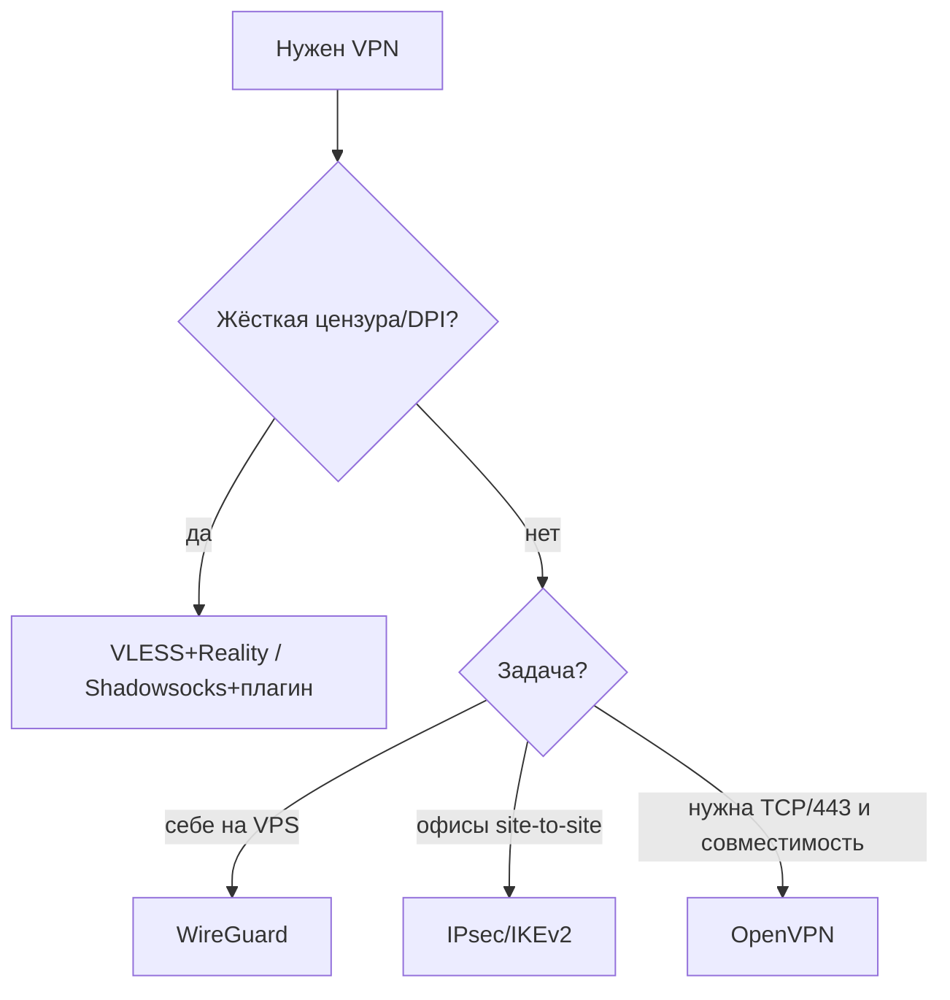

# Модуль 06 · Протоколы VPN

> [!tip] Интерактивная версия
> Полная версия с играми: откройте `vpn/06-protokoly-vpn.html` в браузере. Внутри: гонка протоколов сквозь цензора с переключателем, диспетчер «какой протокол под задачу» со шпаргалкой и конструктор WireGuard из деталей.

Хаб курса: [[README|VPN: как это работает]] · Прошлый модуль: [[05-shifrovanie-i-kluchi]] · Следующий: [[07-arhitektury-vpn]]

## Содержание

1. [Зачем так много протоколов](#зачем-так-много-протоколов)
2. [OpenVPN: гибкий ветеран](#openvpn-гибкий-ветеран)
3. [WireGuard: меньше кода — быстрее туннель](#wireguard-меньше-кода--быстрее-туннель)
4. [IPsec/IKEv2: корпоративный стандарт](#ipsecikev2-корпоративный-стандарт)
5. [Shadowsocks и VLESS: не VPN, а прокси — и почему это оружие против цензуры](#shadowsocks-и-vless-не-vpn-а-прокси--и-почему-это-оружие-против-цензуры)
6. [DPI: как трафик узнают и как от него прячутся](#dpi-как-трафик-узнают-и-как-от-него-прячутся)
7. [Скорость и цена: сравнение](#скорость-и-цена-сравнение)
8. [Что выбирать и когда](#что-выбирать-и-когда)
9. [Итог](#итог)
10. [Словарик сокращений](#словарик-сокращений)
11. [Источники](#источники)

---

## Зачем так много протоколов

Модуль [[05-shifrovanie-i-kluchi]] объяснил, как внутри туннеля рождается ключ и почему провайдер видит шум. Но «туннель» — это не одна программа. VPN (Virtual Private Network — виртуальная частная сеть) — это семейство протоколов, и каждый решает свою задачу:

- **OpenVPN** — ветеран: максимальная гибкость и совместимость, работает даже там, где всё запрещено.
- **WireGuard** — спринтер: минимум кода, максимальная скорость, современная криптография.
- **IPsec/IKEv2** — корпоративный стандарт: встроен в сами операционные системы, король site-to-site.
- **Shadowsocks / VLESS** — строгие прокси-протоколы: формально не VPN, но главное оружие против жёсткой цензуры.

Они отличаются устройством, скоростью, способом прятаться от DPI (Deep Packet Inspection — глубокий анализ трафика) и тем, сколько кода приходится аудировать. Разберём каждого, а в конце — таблица «что выбирать и когда».

## OpenVPN: гибкий ветеран

OpenVPN живёт с 2001 года и до сих пор один из самых популярных протоколов коммерческих VPN-сервисов.

**Устройство:**

- Работает **в пользовательском пространстве** (userspace): пакеты копируются из ядра в программу и обратно. Это гибко, но добавляет накладные расходы.
- Внутри — полноценный **TLS** (Transport Layer Security — протокол защиты соединений) с сертификатами и удостоверяющими центрами (PKI, Public Key Infrastructure — инфраструктура открытых ключей): тот же замок, что у HTTPS-сайтов.
- Транспорт на выбор: **UDP** (User Datagram Protocol — быстрая доставка без подтверждений) для скорости или **TCP** (Transmission Control Protocol — доставка с подтверждениями) на порту **443** — тот же порт и протокол, что у HTTPS. Для цензора трафик «похож на сайт».
- Шифры согласуются (negotiated) при рукопожатии (crypto-agility): AES-GCM, ChaCha20-Poly1305 и десятки других.

**Плюсы:** зрелость (проверен временем и аудитами), гибкость настроек, работает почти везде, умеет маскироваться под HTTPS.

**Минусы:** медленнее WireGuard (userspace + тяжёлый TLS-handshake), огромный код (сотни тысяч строк — больше поверхности для багов), конфигурация на сотни строк, в которой легко запутаться.

## WireGuard: меньше кода — быстрее туннель

WireGuard (2015–2020, с версии ядра Linux 5.6 — встроен в ядро) — полная противоположность OpenVPN:

- **~4000 строк кода** вместо сотен тысяч: меньше багов, проще аудит.
- Работает **в ядре** (kernel space): пакеты не копируются в userspace — отсюда гигабиты на скромном железе.
- **Никакого выбора шифров** (сознательное решение): всегда Noise_IK-рукопожатие, X25519 (DH, Diffie-Hellman — обмен ключами), ChaCha20-Poly1305 (AEAD, Authenticated Encryption with Associated Data — шифрование с проверкой подлинности), BLAKE2s. Меньше параметров — меньше способов ошибиться.
- **Идентичность = пара ключей**, никаких сертификатов и удостоверяющих центров: публичный ключ сервера вписывается в конфиг клиента «из рук в руки» (модуль [[05-shifrovanie-i-kluchi]]).
- Рукопожатие укладывается в **1 RTT** (round-trip time — время туда-обратно), а ответ сервера — вообще в 0-RTT; при потере пакетов переспрашивает ключи автоматически.
- **Роуминг**: клиент меняет сеть (Wi-Fi → LTE) — сервер просто запоминает новый адрес («липкое рукопожатие», sticky handshake), туннель не рвётся.

**Минусы:** только UDP (если сеть режет UDP — WireGuard не запустится); каждому клиенту нужен статичный внутренний IP (приватность-грабли: сервер ведёт сопоставление ключ ↔ адрес); нет встроенной аутентификации пользователей (ключи раздаёт админ); а главное — **уникальный «почерк»**: рукопожатие WireGuard легко узнаётся DPI и блокируется там, где VPN запрещают.

## IPsec/IKEv2: корпоративный стандарт

IPsec (Internet Protocol Security) — не одна программа, а **стандарт**, встроенный в сам стек IP:

- **IKEv2** (Internet Key Exchange v2) — протокол рукопожатия: договаривается о ключах (DH + сертификаты или pre-shared key), создаёт пару «IKE SA + Child SA».
- **ESP** (Encapsulating Security Payload) — шифрует сами пакеты.
- Реализации живут **в ядрах ОС**: Windows, macOS, iOS и Android умеют IPsec «из коробки», без сторонних приложений.
- **MOBIKE** — роуминг при смене сети (как у WireGuard, но появилось раньше).

**Где король:** site-to-site между офисами (модуль [[07-arhitektury-vpn]]), корпоративные шлюзы, роутеры и фаерволы (Mikrotik, Cisco, Fortinet) — всё это говорит на IPsec нативно.

**Минусы:** стандарт старше WireGuard и сложнее: две фазы рукопожатия, куча режимов и опций, в которых исторически рождались уязвимости; пользовательские реализации (strongSwan, libreswan) тяжелее в настройке. Для «VPN себе на VPS» сегодня обычно выбирают WireGuard.

## Shadowsocks и VLESS: не VPN, а прокси — и почему это оружие против цензуры

Строгая разница: VPN-протоколы (выше) создают **туннель для всего трафика** на уровне IP. Shadowsocks и VLESS — **шифрованные прокси**: они пересылают через границу только соединения приложений (обычно SOCKS5/HTTP), и по умолчанию не перехватывают весь трафик ОС (на телефоне — приложения сами умеют ходить через локальный прокси; на десктопе можно завернуть в TUN-режим).

**Shadowsocks** (2012, родился в Китае):

- Лёгкий шифрованный прокси: клиент ↔ сервер обмениваются AEAD-шифротекстом, который выглядит как случайные байты.
- Очень быстрый, минимальный расход батареи, поднимается за минуту.
- Слабость: у трафика нет «легенды» — он просто случайный. DPI научился узнавать такие паттерны статистически (длины пакетов, энтропия, характер обмена), а активное зондирование сервера выдаёт, что за ним нет настоящего сайта.

**VLESS + Reality** (экосистема XTLS/Xray):

- VLESS — протокол-транспорт без собственного шифрования: безопасность зависит от того, во что он завёрнут.
- **Reality** — транспорт-хамелеон: сервер ведёт **настоящую TLS-сессию**, мимикрируя под реальный популярный сайт («сайт-прикрытие»). Цензор делает активное зондирование — стучится на тот же IP — и получает ответ настоящего сайта: неотличимо. Подделать могут только владельцы приватного ключа «прикрытия», а он у них и остаётся.
- На сегодня Reality — фактический стандарт обхода самого жёсткого DPI.

**Итог по прокси:** они не дают «VPN для всей ОС из коробки», зато их главное качество — **неотличимость от обычного HTTPS**, что в странах с агрессивной цензурой важнее удобства.

## DPI: как трафик узнают и как от него прячутся

DPI-цензор смотрит на трафик в несколько слоёв:

| Что смотрит DPI | Как прячутся протоколы |
|---|---|
| **Порт** (51820? значит UDP-туннель) | OpenVPN на TCP/443; Reality на 443 |
| **Сигнатуры заголовков** (формат init-пакета WireGuard, приветствия OpenVPN) | обфускация: OpenVPN-плагины (obfs), амнезия на уровне протокола |
| **Статистика** (длины пакетов, тайминги, энтропия) | Shadowsocks-плагины (simple-obfs, v2ray-plugin), помехи-«приманки» |
| **Активное зондирование** (постучаться на сервер и посмотреть, кто ответит) | Reality: отвечает настоящий сайт-прикрытие |
| **SNI** (какой домен в TLS-привете) | Reality подделывает SNI под прикрытый сайт; ECH у нового TLS |

Отсюда расклад по странам с жёсткой фильтрацией: чистый WireGuard блокируется по сигнатуре; OpenVPN на 443 живёт дольше, но эвристики его достают; Shadowsocks без плагинов ловят статистикой; VLESS+Reality проходит там, где не прошло ничего остальное.

## Скорость и цена: сравнение

| Протокол | Где живёт | Рукопожатие | Скорость | Заметность для DPI |
|---|---|---|---|---|
| WireGuard | ядро | 1 RTT (Noise_IK) | ★★★★★ | высокая (уникальная сигнатура) |
| OpenVPN (UDP) | userspace | 2+ RTT (полный TLS) | ★★★ | средняя |
| OpenVPN (TCP/443) | userspace | 2+ RTT | ★★ (TCP-накладные) | низкая-средняя (похож на HTTPS) |
| IPsec/IKEv2 | ядро ОС | 2 фазы IKE | ★★★★ | средняя |
| Shadowsocks | userspace (лёгкий) | минимальное | ★★★★ | средняя (статистика) |
| VLESS+Reality | userspace | 1 RTT (мимикрия TLS) | ★★★★ | очень низкая |

Закономерность: **чем лучше протокол прячется, тем меньше он похож на «VPN в учебнике»** — и наоборот: эталонный по скорости WireGuard узнаётся легче всех.

## Что выбирать и когда

| Задача | Протокол | Почему |
|---|---|---|
| Свой VPN на VPS (Virtual Private Server — арендованный сервер), скорость и простота | **WireGuard** | ядро, 1 RTT, конфиг из 10 строк, минимум кода под аудит |
| Страна с жёстким DPI | **VLESS+Reality** (или Shadowsocks с плагинами) | неотличим от настоящего HTTPS, переживает активное зондирование |
| Нужен TCP/443 и максимальная совместимость со старым железом | **OpenVPN** | умеет всё, работает везде, маскируется под HTTPS |
| Офис ↔ офис (site-to-site), корпоративные роутеры | **IPsec/IKEv2** | нативен для фаерволов и ОС, стандарт для филиалов |
| Корпоративный удалённый доступ без сторонних приложений | **IKEv2** | встроен в Windows/macOS/iOS/Android |
| Мобильный клиент с роумингом между сетями | **WireGuard** или **IKEv2 (MOBIKE)** | оба переживают смену сети без разрыва |

## Итог

Протоколы — это инструменты под задачи: **WireGuard** — скорость и минимализм, **OpenVPN** — гибкость и совместимость, **IPsec/IKEv2** — корпоративный стандарт из коробки, **Shadowsocks/VLESS+Reality** — маскировка под обычный веб-трафик там, где VPN блокируют. В следующем модуле соберём из них архитектуры: клиент-сервер, site-to-site и mesh — [[07-arhitektury-vpn]].

## Словарик сокращений

| Сокращение | Расшифровка | По-простому |
|---|---|---|
| VPN | Virtual Private Network | приватный туннель (модуль 01) |
| DPI | Deep Packet Inspection | цензор, который нюхает трафик |
| TLS | Transport Layer Security | замок HTTPS |
| TCP | Transmission Control Protocol | надёжная почта с подтверждениями |
| UDP | User Datagram Protocol | быстрая почта без уведомлений |
| PKI | Public Key Infrastructure | фабрика сертификатов и цепочек доверия |
| RTT | Round-Trip Time | время «туда-обратно» |
| DH | Diffie-Hellman | обмен ключами на виду у всех (модуль 05) |
| AEAD | Authenticated Encryption with Associated Data | шифр с проверкой подлинности пакета |
| IPsec | Internet Protocol Security | стандарт шифрования на уровне IP |
| IKE | Internet Key Exchange | рукопожатие IPsec |
| ESP | Encapsulating Security Payload | шифрующая часть IPsec |
| SA | Security Association | договорённость о параметрах защиты в IPsec |
| VPS | Virtual Private Server | арендованный сервер в дата-центре |
| SNI | Server Name Indication | «какой домен» в TLS-привете |
| SOCKS | SOCKS5 | протокол прокси для приложений |

## Источники

- [RFC 8985 — The WireGuard VPN Protocol](https://datatracker.ietf.org/doc/html/rfc8985) — устройство WireGuard
- [WireGuard Whitepaper](https://www.wireguard.com/papers/wireguard.pdf) — криптография и производительность
- [RFC 7296 — Internet Key Exchange Protocol Version 2 (IKEv2)](https://datatracker.ietf.org/doc/html/rfc7296) — рукопожатие IPsec
- [RFC 4301 — Security Architecture for IP](https://datatracker.ietf.org/doc/html/rfc4301) — архитектура IPsec/ESP
- [OpenVPN — официальный сайт и документация](https://openvpn.net/community-resources/) — возможности и настройки
- [Shadowsocks — официальный сайт](https://shadowsocks.org/) — устройство прокси
- [XTLS/Reality — GitHub](https://github.com/XTLS/Reality) — мимикрия TLS против DPI
- [V2Fly — документация VLESS](https://www.v2fly.org/) — экосистема прокси-протоколов
