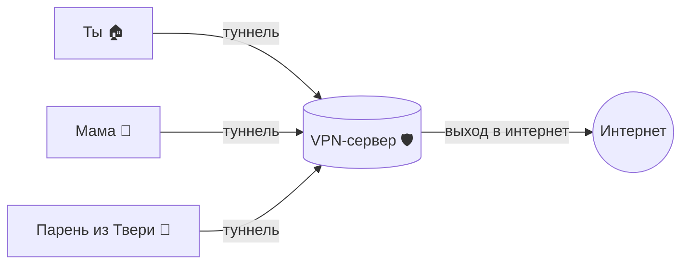
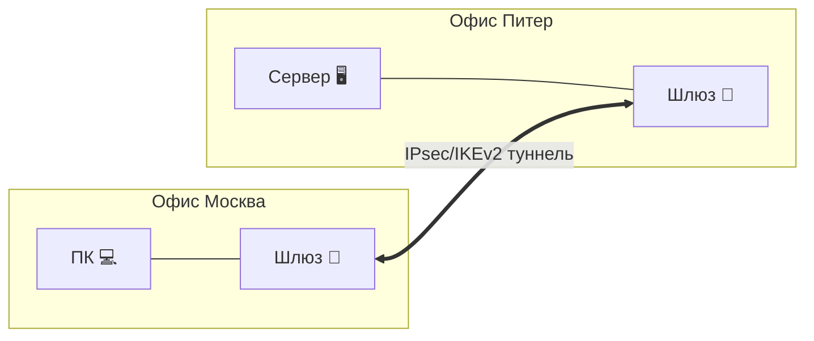
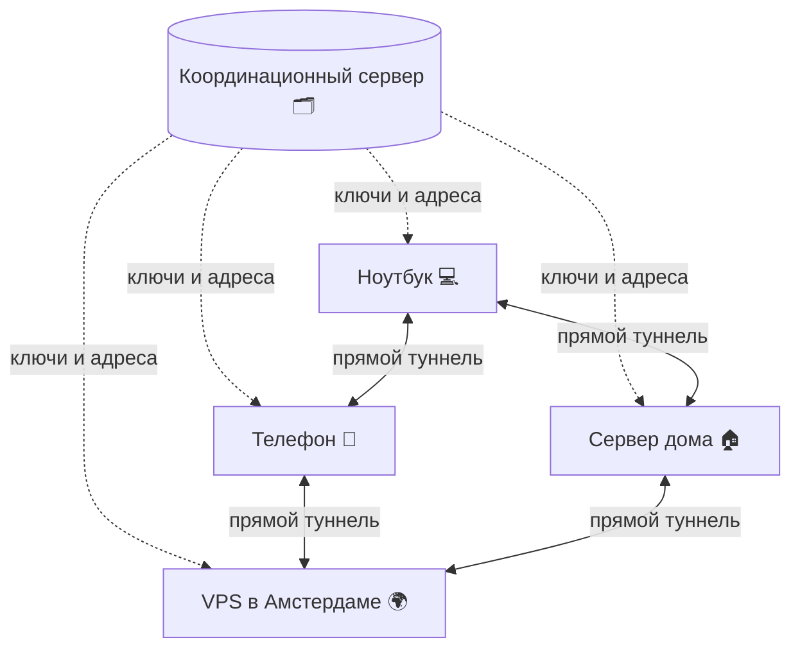
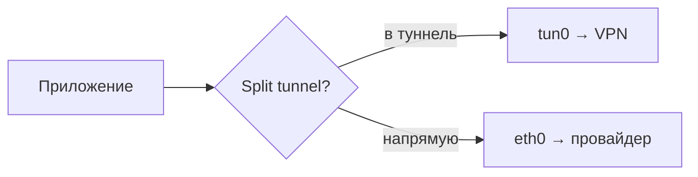

# Модуль 07 · Архитектуры VPN

> [!tip] Интерактивная версия
> Полная версия с играми: откройте `vpn/07-arhitektury-vpn.html` в браузере. Внутри: симулятор трёх архитектур (клиент-сервер / site-to-site / mesh) с переключателем, игра «full vs split tunnel» и конструктор топологии сети.

Хаб курса: [[README|VPN: как это работает]] · Прошлый модуль: [[06-protokoly-vpn]] · Следующий: [[08-mitm-i-tls]]

## Содержание

1. [Один протокол — много форм](#один-протокол--много-форм)
2. [Клиент-сервер: классика приватности](#клиент-сервер-классика-приватности)
3. [Site-to-site: офисы как одна сеть](#site-to-site-офисы-как-одна-сеть)
4. [Mesh: каждый с каждым без центрального сервера](#mesh-каждый-с-каждым-без-центрального-сервера)
5. [Full tunnel vs split tunnel: весь трафик или только часть](#full-tunnel-vs-split-tunnel-весь-трафик-или-только-часть)
6. [Что выбирать и когда](#что-выбирать-и-когда)
7. [Итог](#итог)
8. [Словарик сокращений](#словарик-сокращений)
9. [Источники](#источники)

---

## Один протокол — много форм

Модуль [[06-protokoly-vpn]] разобрал, *чем* туннели отличаются друг от друга (WireGuard, OpenVPN, IPsec, VLESS). Этот модуль — про то, *как* их соединяют в сети. Один и тот же протокол может работать в совершенно разных архитектурах:

- **Клиент-сервер** — ты подключаешься к одному удалённому серверу, весь трафик идёт через него. Классика коммерческих VPN и личных VPS (Virtual Private Server — арендованный сервер).
- **Site-to-site** — два офиса (или два дата-центра) соединены постоянным туннелем, будто они в одной локальной сети. Корпоративный стандарт.
- **Mesh** — каждое устройство знает про каждое другое и соединяется напрямую, без единого центрального сервера. Tailscale, Headscale, ZeroTier.

Выбор архитектуры определяет, кто видит чей трафик, где находится точка отказа и как масштабируется сеть. Разберём каждую.

## Клиент-сервер: классика приватности

Самая знакомая схема: **один сервер, много клиентов**. Каждый клиент устанавливает туннель к серверу, сервер выступает точкой выхода (exit node, модуль [[04-pochemu-menyaetsya-ip]]).

**Как работает:**

- Каждый клиент аутентифицируется на сервере (ключ WireGuard, сертификат OpenVPN, логин/пароль коммерческого VPN).
- Сервер ведёт NAT-таблицу (Network Address Translation — преобразование адресов): какой туннель ↔ какой внешний порт.
- Весь трафик клиента проходит через сервер: сервер видит всё в открытом виде после расшифровки.

**Плюсы:** простая модель, один сервер легко администрировать, точка выхода одна — легко контролировать географию IP.

**Минусы:** сервер — единая точка отказа и единая точка доверия. Если сервер взломают или арестуют — все клиенты под ударом. Трафик между двумя клиентами **не идёт напрямую**: чтобы передать файл коллеге, оба гоняют данные через сервер (двойной расход полосы).

**Где используется:** коммерческие VPN-сервисы (NordVPN, Mullvad), личный WireGuard/OpenVPN на VPS, корпоративный удалённый доступ сотрудников.

## Site-to-site: офисы как одна сеть

Два (или больше) физических мест соединены **постоянным туннелем между шлюзами**. Для устройств внутри обоих офисов это выглядит как одна локальная сеть (LAN, Local Area Network).

**Как работает:**

- На каждом конце стоит **шлюз** (роутер, фаервол, специализированное устройство): Mikrotik, Cisco, Fortinet, pfSense.
- Шлюзы договариваются о туннеле по **IPsec/IKEv2** (Internet Key Exchange v2 — протокол рукопожатия IPsec, модуль [[06-protokoly-vpn]]) или по WireGuard.
- Маршрутизация статическая или динамическая (OSPF/BGP поверх туннеля): устройства в Москве видят устройства в Питере по внутренним IP, как будто они в одном здании.
- Туннель **постоянный**: шлюзы автоматически восстанавливают его при обрывах (dead peer detection + rekeying).

**Плюсы:** прозрачность для пользователей (не нужен VPN-клиент на каждом ПК), нативная поддержка в корпоративном оборудовании, предсказуемая топология.

**Минусы:** требует оборудования/компетенции на обоих концах, не подходит для мобильных сотрудников, добавление нового офиса = новый туннель к каждому существующему (N² проблема при full mesh между сайтами).

**Где используется:** филиалы компаний, дата-центры, облачные VPC (Virtual Private Cloud — виртуальная приватная сеть в облаке) peering.

## Mesh: каждый с каждым без центрального сервера

**Mesh-сеть (mesh network — ячеистая сеть):** нет единого сервера, каждое устройство (peer — узел) знает про другие и соединяется с ними **напрямую**, когда это возможно. Координацией занимается легковесный **координационный сервер** (coordination server), который не пропускает через себя трафик — только обменивается ключами и адресами.

**Как работает (на примере Tailscale/WireGuard):**

1. Каждое устройство регистрируется на координационном сервере и получает пару ключей.
2. Координационный сервер раздаёт всем **публичные ключи и текущие адреса** остальных узлов.
3. Устройства пытаются установить **прямой P2P-туннель** (peer-to-peer — «равный к равному») друг к другу через NAT traversal (проход через NAT): UDP hole punching, STUN/TURN.
4. Если прямой путь невозможен (симметричный NAT, двойной NAT), трафик идёт через **relay-сервер** (DERP в Tailscale) — но это fallback, а не норма.
5. Адресация — стабильные виртуальные IP (например, 100.x.y.z в Tailscale): не зависят от физического местоположения и смены сети.

**Плюсы:** нет единой точки отказа (координационный сервер не видит трафик), прямые соединения = минимальная задержка, автоматический роуминг (смена Wi-Fi/LTE не рвёт туннель), простота добавления новых узлов.

**Минусы:** зависит от NAT traversal (иногда прямой путь невозможен), координационный сервер всё равно знает, кто с кем общается (метаданные), сложнее отладка при проблемах.

**Где используется:** Tailscale, Headscale (self-hosted), ZeroTier, NetBird, Cloudflare WARP (частично). Идеально для распределённых команд, home lab, доступа к личным серверам.

## Full tunnel vs split tunnel: весь трафик или только часть

Независимо от архитектуры, есть выбор: **что именно** пускать в туннель.

### Full tunnel (полный туннель)

Весь трафик устройства идёт через VPN. Таблица маршрутизации: `0.0.0.0/0 → tun0` (модуль [[03-tunnel-i-perehvat-trafika]]).

- **Плюс:** максимальная приватность — провайдер видит только внешний конверт до VPN-сервера.
- **Минус:** весь трафик, включая локальный (принтеры, NAS, умный дом), идёт через туннель. Банковские приложения могут ругаться на «чужую страну». Скорость ограничена пропускной способностью VPN-сервера.

### Split tunnel (раздельное туннелирование)

В туннель идёт только выбранный трафик. Остальное — напрямую через обычного провайдера.

- **Реализация:** избирательные маршруты в таблице: `10.8.0.0/24 → tun0` (только внутренняя сеть VPN), или наоборот — исключения для конкретных адресов.
- **Плюс:** локальные ресурсы доступны напрямую, банковские приложения работают, скорость для «обычного» интернета не страдает.
- **Минус:** трафик вне туннеля провайдер видит полностью. Утечка DNS мимо туннеля — частая проблема (модуль [[09-utechki-i-ogranicheniya]]).

**Когда что:** full tunnel — для приватности и обхода блокировок; split tunnel — для корпоративного доступа к внутренним ресурсам без потери скорости на остальной интернет.

## Что выбирать и когда

| Задача | Архитектура | Протокол | Почему |
|---|---|---|---|
| Приватность в интернете, обход блокировок | клиент-сервер | WireGuard / VLESS+Reality | простая точка выхода, география IP |
| Удалённый доступ сотрудника к офису | клиент-сервер | IKEv2 / WireGuard | встроен в ОС, роуминг |
| Два офиса ↔ одна сеть | site-to-site | IPsec/IKEv2 | нативно для роутеров, постоянный туннель |
| Распределённая команда, home lab | mesh | WireGuard (Tailscale) | прямые P2P, авто-роуминг, нет единой точки |
| Доступ к внутренним ресурсам + обычный интернет | любой + split tunnel | любой | локальное остаётся локальным |
| Максимальная приватность | любой + full tunnel | WireGuard / OpenVPN | весь трафик через туннель |

## Итог

Архитектура — это **форма**, протокол — **содержание**. Один и тот же WireGuard может работать как клиент-сервер (личный VPN), как site-to-site (два роутера) и как mesh (Tailscale). Выбор формы определяет, кто кому доверяет, где точка отказа и как трафик течёт физически. В следующем модуле разберём, что происходит, когда кто-то встаёт посреди туннеля: MITM-атаки и корпоративный VPN как «легальный перехватчик» — [[08-mitm-i-tls]].

## Словарик сокращений

| Сокращение | Расшифровка | По-простому |
|---|---|---|
| VPN | Virtual Private Network | приватный туннель (модуль 01) |
| VPS | Virtual Private Server | арендованный сервер в дата-центре |
| LAN | Local Area Network | локальная сеть (один офис/дом) |
| NAT | Network Address Translation | штамп-машина адресов (модуль 04) |
| P2P | Peer-to-Peer | соединение «равный к равному», без посредника |
| OSPF | Open Shortest Path First | протокол динамической маршрутизации |
| BGP | Border Gateway Protocol | протокол маршрутизации между сетями |
| VPC | Virtual Private Cloud | виртуальная сеть в облаке |
| STUN | Session Traversal Utilities for NAT | протокол обнаружения внешнего адреса за NAT |
| TURN | Traversal Using Relays around NAT | relay-сервер, когда прямой P2P невозможен |
| DERP | Designated Encrypted Relay for Packets | relay-сервер Tailscale |
| IKE | Internet Key Exchange | рукопожатие IPsec (модуль 06) |

## Источники

- [RFC 8985 — The WireGuard VPN Protocol](https://datatracker.ietf.org/doc/html/rfc8985) — основа mesh-сетей на WireGuard
- [Tailscale — How Tailscale works](https://tailscale.com/blog/how-tailscale-works/) — координация, DERP, NAT traversal
- [Headscale — Self-hosted Tailscale control server](https://github.com/juanfont/headscale) — open-source альтернатива координационному серверу
- [ZeroTier — Manual](https://docs.zerotier.com/) — другая mesh-сеть
- [RFC 7296 — IKEv2](https://datatracker.ietf.org/doc/html/rfc7296) — site-to-site на IPsec
- [Cloudflare — Split Tunnels (Zero Trust)](https://developers.cloudflare.com/cloudflare-one/networks/connectors/cloudflare-wan/zero-trust/cloudflare-one-client/) — full vs split tunnel в WARP
- [NetBird — How NetBird Works](https://docs.netbird.io/about-netbird/how-netbird-works) — mesh-архитектура на WireGuard
