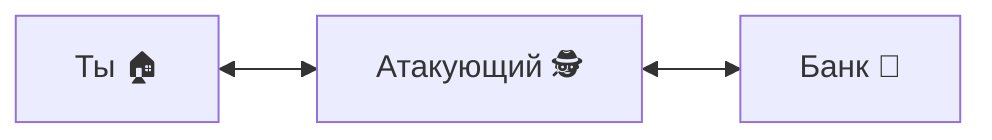

# Модуль 08 · Перехват и «мутация» запросов: MITM

> [!tip] Интерактивная версия
> Полная версия с играми: откройте `vpn/08-mitm-i-tls.html` в браузере. Внутри: атака «человек посередине» в трёх режимах (HTTP / HTTPS / корпоративный подставной сертификат) со step-навигацией и конструктор легального MITM.

Хаб курса: [[README|VPN: как это работает]] · Прошлый модуль: [[07-arhitektury-vpn]] · Следующий: [[09-utechki-i-ogranicheniya]]

## Содержание

1. [Кто такой «человек посередине»](#кто-такой-человек-посередине)
2. [MITM без шифрования: открытка, которую читает каждый](#mitm-без-шифрования-открытка-которую-читает-каждый)
3. [Почему TLS мешает MITM: доверие по цепочке](#почему-tls-мешает-mitm-доверие-по-цепочке)
4. [Легальный MITM: корпоративная инспекция трафика](#легальный-mitm-корпоративная-инспекция-трафика)
5. [При чём тут VPN: чего провайдер НЕ может](#при-чём-тут-vpn-чего-провайдер-не-может)
6. [Новый посредник, которому ты доверяешь](#новый-посредник-которому-ты-доверяешь)
7. [Как защищаться](#как-защищаться)
8. [Итог](#итог)
9. [Словарик сокращений](#словарик-сокращений)
10. [Источники](#источники)

---

## Кто такой «человек посередине»

MITM (Man-in-the-Middle — «человек посередине») — злоумышленник (или просто посредник), который встал **между тобой и сервером** и видит весь обмен:

Ты думаешь, что говоришь с банком. Банк думает, что говорит с тобой. А на самом деле оба говорят с посредником. Он может:

- **читать** всё, что летит в обе стороны;
- **изменять** содержимое на лету (подменить реквизиты, вставить свой скрипт в страницу);
- **выдавать себя** за каждую из сторон перед другой.

Из модулей [[02-kak-rabotaet-internet-bez-vpn]] и [[03-tunnel-i-perehvat-trafika]] мы знаем: пакеты идут через десятки чужих узлов — провайдер, публичный Wi-Fi в кафе, роутеры транзитных операторов. Любой из них **физически может** стать таким посредником. Вопрос только в том, заметит ли это кто-нибудь.

## MITM без шифрования: открытка, которую читает каждый

По HTTP (HyperText Transfer Protocol — протокол веб-страниц) данные летят **открытым текстом**. Посередине атака тривиальна:

1. Ты отправляешь `POST /login` с логином и паролем — посредник их просто читает.
2. Банк отвечает страницей — посредник **подменяет** её на лету: вставляет свою форму, свой скрипт, свои реквизиты.
3. Ни ты, ни банк ничего не замечаете: HTTP не проверяет ни целостность, ни подлинность.

В 2026 году чистый HTTP — это открытка, которую читает каждый почтальон по дороге. Именно поэтому браузеры помечают HTTP-сайты как «Не защищено», а весь современный веб переведён на HTTPS (HyperText Transfer Protocol Secure — HTTP поверх TLS).

## Почему TLS мешает MITM: доверие по цепочке

TLS (Transport Layer Security — протокол защиты соединений, модуль [[05-shifrovanie-i-kluchi]]) добавляет к шифрованию **аутентификацию**: сервер доказывает, что он — это он.

Механика доверия:

1. У банка есть **приватный ключ**, который он никому не показывает, и **сертификат** — «паспорт», выданный удостоверяющим центром, CA (Certificate Authority), где написано «этот публичный ключ принадлежит bank.ru» и стоит подпись CA.
2. В твою ОС/браузер с завода встроен список **доверенных корневых сертификатов** (несколько сотен CA) — это PKI (Public Key Infrastructure — инфраструктура открытых ключей).
3. При рукопожатии банк подписывает данные своим приватным ключом. Браузер проверяет подпись по цепочке: сертификат банка → подпись промежуточного CA → корневой CA из доверенного списка.
4. Атакующий посередине **не может** предъявить сертификат для bank.ru с валидной подписью доверенного CA — приватных ключей CA у него нет. Подделка обрывается на проверке цепочки: браузер показывает предупреждение (`NET::ERR_CERT_AUTHORITY_INVALID`).

Итог: наивный MITM против HTTPS ломается не о шифрование, а о **доверие**. Перехватить канал можно — представиться банком нельзя.

**Оговорка:** доверие работает ровно настолько, насколько честен список корневых сертификатов. И здесь появляется главный сюжетный поворот модуля.

## Легальный MITM: корпоративная инспекция трафика

Компании (и некоторые провайдеры/госорганы) ставят **инспектирующие шлюзы**: весь HTTPS сотрудников проходит через коробку, которая:

1. Имеет **собственный корневой сертификат CA**, заранее установленный в доверенные на всех корпоративных устройствах.
2. Перехватывает TLS-соединение сотрудника к любому сайту.
3. **На лету выпускает поддельный сертификат** для этого сайта — подписанный своим CA. Браузер проверяет цепочку… и она проходит! Свой CA ведь «доверенный».
4. Расшифровывает трафик, проверяет его (антивирус, DLP — Data Loss Prevention — защита от утечек), **шифрует заново** настоящим сертификатом сайта и отправляет дальше.

Получаются **два TLS-соединения вместо одного**: ты ↔ шлюз (поддельный замок) и шлюз ↔ сайт (настоящий замок). Для пользователя всё выглядит идеально: замочек в адресной строке горит, сертификат «валиден».

Это не взлом — это **дизайн**: кто контролирует хранилище доверенных корневых сертификатов на твоём устройстве, тот может молча читать любой твой HTTPS. Отсюда два практических вывода:

- не устанавливать незнакомые корневые сертификаты «по инструкции из чата» — это буквально ключи от всех твоих замков;
- не пользоваться онлайн-банком с корпоративного ноутбука: его трафик может расшифровываться штатно и логироваться.

Та же механика встречается и «в дикой природе»: некоторые публичные Wi-Fi, антивирусы с «HTTPS-сканированием» и национальные системы фильтрации работают по той же схеме со своим корневым сертификатом.

## При чём тут VPN: чего провайдер НЕ может

Вернёмся к курсу. В модулях [[05-shifrovanie-i-kluchi]] и [[06-protokoly-vpn]] мы собрали туннель: твой трафик шифруется ключами, о которых договорились **только ты и VPN-сервер** (DH + аутентификация сервера). Что это меняет для провайдера-посредника:

- **Читать** — не может: внутри туннеля шифротекст, ключей у него нет.
- **Подменять** — не может: каждый пакет защищён AEAD-кодом подлинности (модуль 05) — любая мутация пакета будет немедленно замечена клиентом.
- **Выдать себя за VPN-сервер** — не может: у клиента закреплен публичный ключ сервера (WireGuard) или проверяется сертификат (OpenVPN). Подставной сервер не пройдёт рукопожатие.

То есть VPN-туннель **убивает MITM-возможности провайдера** на участке «ты ↔ VPN-сервер». Публичный Wi-Fi в кафе перестаёт быть страшным: даже если кафе — злой посредник, у него только шум.

## Новый посредник, которому ты доверяешь

Честная ложка дёгтя: VPN не уничтожает посредника — он **заменяет** его. Точка выхода (exit node, модуль [[04-pochemu-menyaetsya-ip]]) видит весь твой трафик в открытом виде:

| Посредник | До включения VPN | После включения VPN |
|---|---|---|
| Провайдер/Wi-Fi | видит всё | видит только шум туннеля |
| VPN-провайдер | не участвует | видит ВСЁ: адреса, домены, содержимое |
| Сайт | видит твой IP | видит IP VPN-сервера |

Поэтому выбор VPN — это выбор того, **кому** ты передаёшь роль единственного посредника. Отсюда же растут советы: выбирать сервисы с политикой no-logs и аудитами, а для максимальной приватности — поднимать свой сервер (модуль [[10-praktika-svoi-vpn]]).

## Как защищаться

- **HTTPS везде** — для сайтов это уже норма; проверяй замочек и не игнорируй предупреждения о сертификатах («посмотреть всё равно» = отдать трафик посреднику).
- **Не устанавливать чужие корневые сертификаты** без железного понимания зачем. Каждый установленный корень — потенциальный легальный MITM всего твоего трафика.
- **HSTS** (HTTP Strict Transport Security — принудительный HTTPS) и **Certificate Transparency** (публичные журналы всех выданных сертификатов) — индустриальные механизмы: первый не даёт спуститься на HTTP, второй делает «тихий» выпуск поддельных сертификатов заметным.
- **Разделяй контексты**: банковские операции — с личного устройства и личной сети; корпоративный ноутбук — для работы.
- **VPN в недоверенных сетях** (кафе, аэропорт, отель): туннель защищает от MITM на месте, но помни, кому доверяешь на выходе.

## Итог

MITM — это не экзотический взлом, а штатная позиция любого посредника в интернете. TLS превращает наивный перехват в бессмысленное подглядывание в замочную скважину шифротекста — но только пока список доверенных сертификатов не скомпрометирован. VPN закрывает участок до сервера от любого местного посредника, превращая провайдера и злой Wi-Fi в «слепого курьера», — но передаёт всю полноту доверия VPN-серверу. Дальше разберём, где эта конструкция всё-таки протекает: DNS и WebRTC мимо туннеля, kill switch и мифы — [[09-utechki-i-ogranicheniya]].

## Словарик сокращений

| Сокращение | Расшифровка | По-простому |
|---|---|---|
| MITM | Man-in-the-Middle | посредник между тобой и сервером |
| TLS | Transport Layer Security | замок HTTPS |
| HTTP | HyperText Transfer Protocol | открытый протокол веба |
| HTTPS | HTTP Secure | HTTP внутри TLS-туннеля |
| CA | Certificate Authority | тот, кто выдаёт сертификаты |
| PKI | Public Key Infrastructure | фабрика доверия: сертификаты и цепочки |
| VPN | Virtual Private Network | приватный туннель (модуль 01) |
| DLP | Data Loss Prevention | корпоративная защита от утечек |
| HSTS | HTTP Strict Transport Security | «только HTTPS, никаких исключений» |
| AEAD | Authenticated Encryption with Associated Data | шифр, ловящий подмену пакета (модуль 05) |
| DH | Diffie-Hellman | обмен ключами на виду у всех (модуль 05) |

## Источники

- [RFC 8446 — TLS 1.3](https://datatracker.ietf.org/doc/html/rfc8446) — рукопожатие, сертификаты, аутентификация
- [MitM attack — MDN Glossary](https://developer.mozilla.org/en-US/docs/Glossary/MitM) — определение и схемы атаки
- [Certificate Transparency](https://certificate.transparency.dev/) — публичные журналы сертификатов
- [NIST SP 800-52r2 — TLS Implementation Guidelines](https://nvlpubs.nist.gov/nistpubs/SpecialPublications/NIST.SP.800-52r2.pdf) — требования к TLS и сертификатам
- [WireGuard Whitepaper](https://www.wireguard.com/papers/wireguard.pdf) — закрепление публичных ключей как защита от подмены сервера
