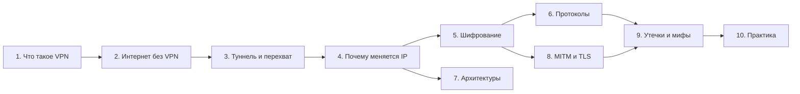

# VPN: как это работает

Учебный курс «по полочкам»: что такое VPN, как он перехватывает и изменяет трафик, почему получается подменить IP-адрес источника, и что при этом видно каждому участнику цепочки.

## Содержание

1. [Формат курса](#формат-курса)
2. [Программа (модули)](#программа-модули)
3. [Конвенции](#конвенции)
4. [Статус](#статус)

---

## Формат курса

Каждый модуль — пара файлов в этой папке:

- `NN-slug.md` — Obsidian-конспект: frontmatter, текст, wikilink-и на другие модули и хаб
- `NN-slug.html` — **интерактивный урок**: анимированные схемы, переключатели состояний, квизы; самодостаточный файл (inline CSS/JS, vanilla), открывается в браузере двойным кликом (в Obsidian — через плагин Surfing или ссылку из .md)

Модули связаны wikilink-ами; этот файл — хаб (входная точка). Общие шаблоны HTML-компонентов — в `templates/`, изображения — в `assets/`.

Целевой читатель: разработчик, который знает HTTP/IP «в общих чертах», но хочет понять механику на уровне пакетов и маршрутов. Манера изложения — максимально простая, «как для десятилетки»: живые аналогии (город, посылки, почтамты, квартиры-порты), короткие предложения; глубина для разработчика живёт в .md-конспектах и источниках.

## Программа (модули)

| № | Файл | Тема | Ключевые вопросы |
|---|------|------|------------------|
| 1 | [[01-chto-takoe-vpn]] | Что такое VPN и зачем он нужен | Какие задачи решает: приватность, обход блокировок, удалённый доступ, site-to-site. Кто что видит без VPN: провайдер, сайт, посредники |
| 2 | [[02-kak-rabotaet-internet-bez-vpn]] | База: путь пакета без VPN | IP и порты, маршрутизация, NAT у провайдера, TLS. Что такое «IP источника» и кто его узнаёт |
| 3 | [[03-tunnel-i-perehvat-trafika]] | Туннелирование: как VPN «перехватывает» трафик | TUN/TAP-интерфейсы, изменение таблицы маршрутизации, default route через туннель. Инкапсуляция: пакет в пакете. Split tunneling |
| 4 | [[04-pochemu-menyaetsya-ip]] | Почему меняется IP источника | NAT на VPN-сервере, exit node, обратный путь ответа через туннель. Что видит конечный сайт. Диаграмма полного пути пакета «туда и обратно» |
| 5 | [[05-shifrovanie-i-kluchi]] | Шифрование внутри туннеля | Симметричная/асимметричная криптография, handshake, обмен ключами (Diffie-Hellman), сессии. Почему провайдер видит только «шум» |
| 6 | [[06-protokoly-vpn]] | Протоколы: OpenVPN, WireGuard, IPsec/IKEv2, Shadowsocks/VLESS | Устройство и отличия, скорость vs гибкость, обход DPI, что выбирать и когда |
| 7 | [[07-arhitektury-vpn]] | Архитектуры: клиент-сервер, site-to-site, mesh | Классический VPN-сервер, корпоративный site-to-site, mesh-сети (Tailscale/WireGuard), full vs split tunnel |
| 8 | [[08-mitm-i-tls]] | Перехват и «мутация» запросов: MITM | Как выглядит MITM без VPN и почему TLS ему мешает; корпоративный VPN как легальный MITM со своими сертификатами; чем VPN защищает от перехвата провайдером |
| 9 | [[09-utechki-i-ogranicheniya]] | Утечки, ограничения, мифы | DNS leak, WebRTC leak, kill switch. Провайдер VPN видит всё. VPN vs Tor. Что VPN НЕ скрывает |
| 10 | [[10-praktika-svoi-vpn]] | Практика: поднимаем свой VPN | WireGuard-сервер на VPS пошагово, конфигурация клиента, проверка утечек, типичные грабли |

Зависимости модулей:

## Конвенции

- **Язык**: русский, термины — с оригиналом в скобках при первом упоминании (например, «инкапсуляция (encapsulation)»)
- **Аббревиатуры**: расшифровывать ОДИН раз при первом использовании внутри каждого модуля — даже если определение уже давалось в предыдущих модулях; в конце .md — таблица «Словарик сокращений»
- **Игровой интерактив**: утверждённые шаблоны механик (пользователь одобрил сет модуля 02): путь с репликами узлов + кликабельные карточки; конструктор с чипой-обманкой; игра-диспетчер со шпаргалкой-таблицей и событиями; тумблеры состояний; штамп/сборка-анимации; мини-квиз. Каркас — `templates/base-module.html`. В каждом модуле 2–4 механики из набора + по желанию одна экспериментальная.
- **Степ-навигация (обязательна для journey-игр)**: у игр типа «путь с репликами» два режима — «Авто» (кнопка гоняет все шаги с паузами) и ручной («‹ Назад» / «Шаг ›» + счётчик «шаг i из N»); стрелка во время авто отменяет его и перехватывает управление; смена тумблера состояния сбрасывает на шаг 0 (фидбек пользователя, модули 02–03).
- **HTML-модули**: тёмная тема, шрифты Unbounded/Golos Text/JetBrains Mono, анимации с учётом prefers-reduced-motion, mini-квиз в конце каждого модуля
- **Диаграммы**: inline-SVG с JS-анимацией (приоритет); mermaid — в .md-конспектах; растровые иллюстрации (генерация) — в `assets/`
- **Frontmatter**: `title`, `module` (номер), `status` (planning / draft / review / final), `tags`, `interactive` (ссылка на html)
- **Связи**: wikilink-и между модулями; на хаб — ссылка из каждого модуля
- **Проверка**: `npx markdownlint-cli` + `npx markdown-link-check` для .md; HTML — открытие в браузере (console без ошибок, интерактив работает) перед статусом final

## Статус

| Модуль | Статус |
|--------|--------|
| 01 · Что такое VPN | review (v2: аббревиатуры ретро-расшифрованы по новой конвенции) |
| 02 · Интернет без VPN | final (механики утверждены пользователем — стали шаблоном) |
| 03 · Туннель и перехват | draft (ждёт фидбека по играм) |
| 04 · Почему меняется IP | draft (ждёт фидбека по играм) |
| 05 · Шифрование и ключи | final (игры утверждены пользователем) |
| 06 · Протоколы VPN | draft (ждёт фидбека по играм) |
| 07 · Архитектуры VPN | draft (ждёт фидбека по играм) |
| 08 · MITM и TLS | draft (ждёт фидбека по играм) |
| 09–10 | planning |

Конвейер производства: исследование → черновик → самопроверка (lint + link-check) → вычитка → final. Движок — Hermes Agent (скилл `edu-content-pipeline`).
